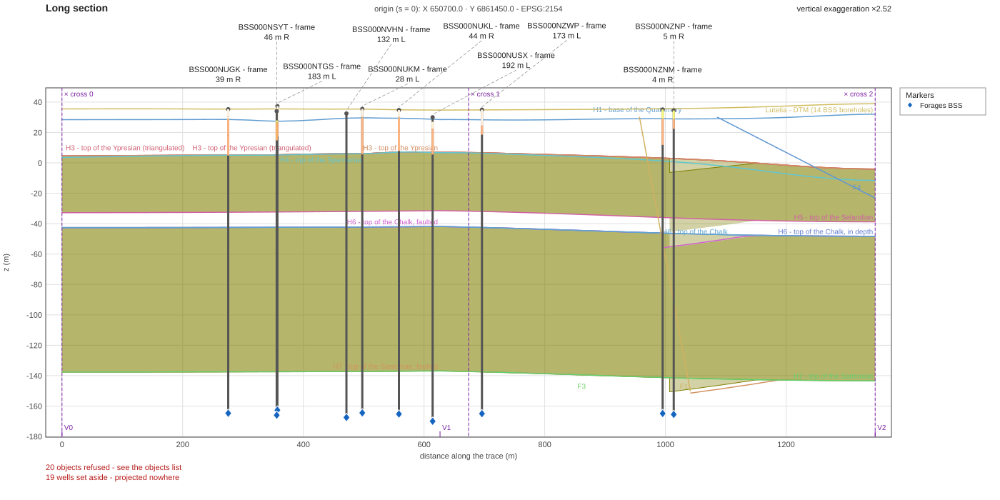

# Lutetia



**Lutetia is a synthetic, multi-domain EnergyML reference model of the Paris Basin around the Louvre.** It is written in RESQML 2.2, Energistics common (EML) 2.3, WITSML 2.1 and PRODML 2.3, as one EPC package with its HDF5 file, and it holds 1 302 data objects of 67 types (see [docs/inventory.md](docs/inventory.md)). A real frame (the area, 19 real boreholes of the French subsurface databank, the BRGM stratigraphic chart) carries invented content (a geothermal doublet, horizons, faults, a grid and its properties, logs and production), and every part says which is which ([docs/context.md](docs/context.md)). Nothing goes deeper than 200 m below the ground. It is a test and teaching model, not a geological study.

> **The BRGM data were modified for this example.** The boreholes come from the BRGM Banque du sous-sol (BSS, Licence Ouverte 2.0); the model extends some of them and adds invented content around them, and every synthetic object says so. Do not use these packages as BSS data ([docs/sources.md](docs/sources.md)).

The package is built by a recipe, not by hand: `recipe/recette.toml` and its inputs are in this repository, and replaying it with the published `energyml` CLI rebuilds the package ([docs/build.md](docs/build.md)). The two BRGM inputs the recipe reads are here: the 23 boreholes as the BRGM API returned them on 23 and 24 September 2026 (it answers differently today), and the stage of each interval, transcribed by hand ([docs/sources.md](docs/sources.md)).

## Download

| Variant | EPC | HDF5 |
|---|---|---|
| **Lutetia** (clean: `energyml check` reports no error) | [package/Lutetia.epc](package/Lutetia.epc) | [package/Lutetia.h5](package/Lutetia.h5) |
| **Lutetia-with-errors** (deliberate errors, for testing checkers) | [package-with-errors/Lutetia.epc](package-with-errors/Lutetia.epc) | [package-with-errors/Lutetia.h5](package-with-errors/Lutetia.h5) |

Keep the `.epc` and the `.h5` of a variant in the same folder: the EPC names its HDF5 file. The files of the two variants currently share their names, so keep each pair in its own folder. The variant with errors is described in [docs/errors.md](docs/errors.md).

## Use it in three lines

With the [`energyml` library and CLI](https://github.com/geosiris-technologies/energyml-rust):

```bash
# CLI
energyml list package/Lutetia.epc && energyml check package/Lutetia.epc
```

```rust
// Rust (crates energyml-storage and energyml-schemas): open the package, list its objects
let store = energyml_storage::EpcStore::open("package/Lutetia.epc", std::sync::Arc::new(energyml_schemas::all()))?;
for s in store.resources() { println!("{}", s.qualified_type); }
```

```python
# Python (the energyml-rust wheel, built from the energyml-rust repository until it is on PyPI)
from energyml.rust.epc import Epc
print(len(Epc.open("package/Lutetia.epc").objects()))
```

## Contents

| Path | What |
|---|---|
| `package/` | the clean model: `Lutetia.epc` + `Lutetia.h5` |
| `package-with-errors/` | the same model plus a set of objects that are wrong on purpose |
| `recipe/` | `recette.toml` (the build recipe) and `donnees/` (every input it reads, the BRGM boreholes and their stages included) |
| `docs/` | [context](docs/context.md), [sources](docs/sources.md), [build](docs/build.md), [inventory](docs/inventory.md), [coverage](docs/coverage.md), [errors](docs/errors.md) |
| `scripts/` | `inventory.py`, which regenerates the inventory; `replay.py`, which plays the recipe into both packages and writes `written-on` (`--redraw` first draws the stored section again, needed after a recipe edit that moves uuids; see [docs/build.md](docs/build.md#replay)) |
| `written-on` | the platform that wrote the packages (see [the contract](#the-energyml_lutetia_dir-contract)) |

## Replaying

`python scripts/replay.py` plays `recipe/recette.toml` with the `energyml` CLI (the version in `recipe/energyml-version`, built with HDF5) into `package/` (the recipe without its `erreur` group) and `package-with-errors/` (the whole recipe), then writes `written-on`. It stages both variants first and replaces the committed files only if both succeed. Every input is in `recipe/donnees/`; nothing is fetched. Files are never renamed by hand: a different file name is obtained by playing the recipe again with another `--out`, or with `energyml rename`.

## The `ENERGYML_LUTETIA_DIR` contract

The `energyml` repository tests its readers and its recipe player against Lutetia. It finds Lutetia through the environment variable `ENERGYML_LUTETIA_DIR`, which must name a directory laid out exactly like a checkout of this repository, at the commit pinned in `energyml/tests/lutetia.lock`. `energyml` fetches it with `python scripts/fetch-lutetia.py --dest target/lutetia`; any other way to build the same directory is fine. The tests read:

| Path (relative to `$ENERGYML_LUTETIA_DIR`) | Content | Required |
|---|---|---|
| `package/Lutetia.epc` and the `.h5` it names (`Lutetia.h5`) | the **clean** model: `energyml check` reports no error and no warning | yes |
| `package-with-errors/Lutetia.epc` (or `Lutetia-with-errors.epc`) and its `.h5` | the model plus the deliberate errors of [docs/errors.md](docs/errors.md). Both spellings are accepted, the first one first | yes |
| `recipe/recette.toml`, `recipe/donnees/…` | the recipe and every input it reads | yes |
| `recipe/energyml-version` | first line: the version of the `energyml` CLI that produced the packages | no (read by the replay, not by the tests) |
| `written-on` | the platform stamp, below | no |

**Names.** `Lutetia` is the clean model. The monorepo of `energyml` spells it the other way round (`web/public/examples/lutetia` is the variant with errors, `lutetia-sans-erreurs` the clean one); in this layout `package/` is always the clean one. An EPC names its `.h5` inside, so the `.epc` and the `.h5` of a variant must stay together and keep the names the EPC refers to.

**`written-on`.** Two lines of text, written by `scripts/replay.py` on the machine that wrote the packages:

```text
linux
arch: x64
```

- line 1: the platform, spelled as node's `process.platform` (`win32`, `linux`, `darwin`);
- line 2, optional: `arch: ` and the architecture, spelled as node's `process.arch` (`x64`, `arm64`).

It decides how a replay is compared with the committed packages. Each platform's maths library may differ by the last bit of a float, and an identifier derived from a position follows that bit. On the machine named in the file (platform, and architecture when given) the replayed EPC must be **byte for byte** the committed one. On any other machine the two are compared **up to float noise** (a relative 1e-8 on every number, objects matched by what they are, no other difference accepted). With no `written-on`, the comparison is byte for byte.

**Version policy (pending).** Which `energyml` version may be compared against which commit of this repository is **not decided yet**: either the replay tests only compare at equal `energyml` versions, or both repositories advance together in one change. Until it is decided, a change to an operation in `energyml` can make its replay tests fail until this repository is regenerated.

## Licences

- **Data** (the packages and the recipe inputs): **CC BY 4.0**, see [LICENSE-data](LICENSE-data). Credit: *Lutetia, a synthetic model by Geosiris, CC BY 4.0. Contains data from the BRGM Banque du sous-sol (BSS), harvested on 23 and 24 September 2026, Licence Ouverte 2.0, modified for this example; and from the BRGM GeolTs chart, CC BY 4.0.* Origins and licences of every input: [docs/sources.md](docs/sources.md).
- **Recipe, scripts and documentation**: Apache-2.0, see [LICENSE](LICENSE).

## Cite

Use [CITATION.cff](CITATION.cff) (GitHub shows a "Cite this repository" button). Its Zenodo DOI is [10.5281/zenodo.23730911](https://doi.org/10.5281/zenodo.23730911) for every version, and [10.5281/zenodo.23730912](https://doi.org/10.5281/zenodo.23730912) for version 1.0.0.

## Links

- Geosiris: <https://www.geosiris.com>
- The library and CLI that build and read Lutetia: <https://github.com/geosiris-technologies/energyml-rust>

## Disclaimer

This project is not affiliated with or endorsed by Energistics or The Open Group. Energistics®, WITSML™, PRODML™ and RESQML™ are trademarks or registered trademarks of Energistics Consortium, Inc.; see [NOTICE](NOTICE).
